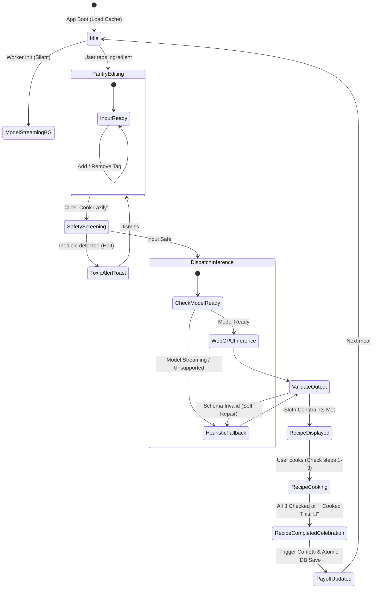

# Introduction

This Technical Specification establishes the authoritative, machine-readable architectural blueprint for **LazyChef & Pantry Autopilot**. LazyChef is a client-side, privacy-preserving, local-first kitchen copilot created for the Hacktoberfest 2026 Week 3: Slow and Steady Challenge (`#hf26challenge`), competing specifically for the **Best Use of Gemma / Open-Weight AI** partner track.

The system enforces strict **Sloth Constraints**—recommending exactly one meal requiring at most one cooking vessel, at most three instructions, and taking 15 minutes or less. It combines a WebGPU-accelerated in-browser Large Language Model (Google Gemma 2B via `@huggingface/transformers` in a dedicated Web Worker), an instant (<15ms) deterministic heuristic fallback engine, local persistence via IndexedDB, dual-layer safety filtering, and an automated Hacktoberfest DevRelay submission exporter.

---

## 1. Purpose & Scope

The purpose of this specification is to define the exact runtime interfaces, data schemas, Web Worker communication contracts, state machines, and heuristic rules required to implement LazyChef without ambiguity.

### In Scope
- **Client-Side Component Architecture**: UI Layer, State Stores, Inference Router, Web Worker WebGPU Pipeline, and Deterministic Heuristic Engine.
- **Web Worker WebGPU Pipeline**: Asynchronous background streaming and quantized execution of Google Gemma 2B (`onnx-community/gemma-2-2b-it-webgpu` or quantized ONNX equivalents) with progress reporting.
- **Deterministic Heuristic Engine**: Zero-latency (<15ms) rule-matrix recipe generator operating without network or GPU dependencies.
- **Data Persistence**: Offline-first storage schemas for IndexedDB (`LazyChefDB`) and `localStorage`.
- **JSON Schema & Sloth Constraint Enforcement**: Structural parsing, validation, and programmatic repair of recipe outputs.
- **Dual-Layer Safety Filter**: Fast lexical/regex screening for toxic non-food items coupled with system-prompt boundaries.
- **UI State Machine**: Reactive state handling for pantry input, background streaming, cooking steps, and celebratory completion.
- **The Lazy Payoff Engine**: Cumulative tracking of decision minutes, grocery dollars, and wash-up vessels saved.
- **Hacktoberfest DevRelay Exporter**: Dynamic markdown generator matching `submission-template.md` with DevRelay agent session embed tags.

---

## 1.1 Out of Scope

- Remote server infrastructure, cloud databases, user registration, or authentication systems.
- Commercial e-commerce checkout, cart synchronizations with third-party grocers, or courier logistics APIs.
- Social feeds, recipe rating forums, comments, or public profile pages.
- Multi-course culinary planning, banquet recipes, or gourmet multi-vessel instructions.
- Third-party tracking pixels, analytics cookies, or cloud telemetry telemetry sinks.

---

## 1.2 Open Questions & Assumptions

### Assumptions Made in this Specification
1. **Model Weights & Runtime**: The application targets `@huggingface/transformers` (v3+ with WebGPU pipeline support). The default model identifier is `onnx-community/gemma-2-2b-it-webgpu` (4-bit quantized ~1.3 GB) with automatic OPFS/Cache API persistence.
2. **WebGPU Availability**: Browsers without WebGPU support (or with disabled flags) seamlessly default to the Deterministic Heuristic Engine with an informative notification toast, while also offering WASM fallback if enabled.
3. **Execution Environment**: Modern Chromium-based browsers, Firefox, or Safari supporting Web Workers, IndexedDB, and ES2022+ features.
4. **Build Architecture**: Vanilla TypeScript managed via Vite for bundling, maintaining an initial core bundle size under 350 KB (excluding cached neural model weights).

> [!NOTE]
> All primary requirements have been validated against the approved PRD and Clarification Report (Readiness Score: 100/100). No open blocking ambiguities remain.

---

## 2. Definitions

All terminology strictly adheres to the project Domain Glossary established in [CONTEXT.md](file:///d:/hacktoberfest/hf-challenges-week-3/CONTEXT.md).

- **Sloth Constraints**: Strict operational limits enforcing maximum one cooking vessel, maximum three steps, and under fifteen minutes preparation time to eliminate culinary effort.
  - _Avoid_: lazy rules, easy filters, quick shortcuts
- **The Lazy Payoff**: The quantified savings in minutes of decision fatigue and grocery waste cost achieved by following minimal-effort meal recommendations.
  - _Avoid_: ROI, time saved score, efficiency metric
- **Pantry State**: The client-side local inventory of currently available food items, staples, and condiments stored without cloud synchronization.
  - _Avoid_: inventory list, food stock, grocery stash
- **Lazy Recipe**: A single deterministic or AI-generated meal recommendation adhering strictly to Sloth Constraints and utilizing existing pantry items.
  - _Avoid_: quick meal, simple dish, fast food
- **Grocery Gap**: The minimal subset of missing essential staples or complementary items flagged for optional replenishment.
  - _Avoid_: missing shopping items, staple shortfall, buy list

---

## 3. Requirements, Constraints & Guidelines

### Functional Requirements
- **REQ-001 (Pantry Inventory Management)**: The system shall permit users to toggle pre-defined pantry tags, input comma-separated custom ingredients, categorize items (Proteins, Carbs, Veggies, Aromatics/Sauces, Dairy/Fats, Staples), and mark items with a "Use Soon" shelf-life urgency tag.
- **REQ-002 (Single Lazy Recipe Generation)**: The system shall output exactly one Lazy Recipe per generation cycle. Generating lists of multiple choices is strictly prohibited.
- **REQ-003 (Sloth Constraint Enforcement)**: Every generated recipe must adhere to:
  1. Exactly 1 cooking vessel (skillet, pot, sheet pan, or microwave bowl).
  2. Maximum 3 concise, imperatively phrased instructions.
  3. Total preparation and cooking time strictly $\le$ 15 minutes.
- **REQ-004 (Asynchronous Web Worker Inference)**: Model initialization, weight downloading, token streaming, and generation must execute in a dedicated Web Worker to maintain an unblocked 60 FPS main UI thread.
- **REQ-005 (Background Weight Streaming & Fallback)**: As specified in [ADR-0001](file:///d:/hacktoberfest/hf-challenges-week-3/docs/adr/0001-automatic-background-model-streaming.md), model weight streaming shall initiate automatically in the background on app load. If the user triggers generation before weights are cached or if WebGPU is absent, the system shall invoke the Deterministic Heuristic Engine in $<15\text{ms}$.
- **REQ-006 (The Lazy Payoff Tracking)**: The system shall record completed meals upon user confirmation ("I Cooked This! 🍳" button or checking all 3 steps), atomically updating cumulative metrics:
  - Decision fatigue avoided: 15 minutes per meal.
  - Money saved from avoided takeout/waste: $6.50 per meal.
  - Dishes avoided: 2 pans per meal.
- **REQ-007 (Grocery Gap Detection)**: The recipe generator shall identify 0 to 2 optional elevating staples not currently in the Pantry State and format them for one-click clipboard copying.
- **REQ-008 (Hacktoberfest DevRelay Exporter)**: The system shall generate a pre-filled markdown post complying with [submission-template.md](file:///d:/hacktoberfest/hf-challenges-week-3/submission-template.md), integrating dynamic Lazy Payoff metrics and an embeddable `` Liquid tag.

### Security & Privacy Requirements
- **SEC-001 (Zero External Telemetry)**: No pantry inventory, consumption habits, or device telemetry shall ever be transmitted across external network boundaries.
- **SEC-002 (Dual-Layer Safety Filter)**:
  - **Layer 1 (Lexical Blocklist)**: Input text shall be checked against a blocklist of non-food/toxic terms (cleaning agents, petroleum products, inedible polymers, medications). Matches immediately halt processing and display an alert toast.
  - **Layer 2 (Model System Boundary)**: The LLM prompt must enforce a strict culinary-only boundary, emitting an `INEDIBLE_INPUT` code if toxic inputs bypass Layer 1.

### Architectural Constraints
- **CON-001 (WebGPU Tiered Degradation)**: Tier 1: WebGPU Gemma 2B $\rightarrow$ Tier 2: WASM quantized fallback $\rightarrow$ Tier 3: Deterministic Heuristic Engine.
- **CON-002 (Bundle Budget)**: The core client application bundle (HTML/CSS/JS) must remain $\le 350\text{ KB}$ gzipped (excluding model weight files stored in Cache/OPFS).
- **CON-003 (Zero Server Dependency)**: The application must operate fully offline via a Service Worker once initial assets and models are cached.

---

## 4. Interfaces & Data Contracts

### 4.1 System Component Architecture

```
┌──────────────────────────────────────────────────────────────────────────┐
│                             MAIN BROWSER THREAD                          │
│                                                                          │
│  ┌───────────────────────┐         ┌──────────────────────────────────┐  │
│  │   UI Components &     │ ◄─────► │        App State Store           │  │
│  │   View Layer (DOM)    │         │ (Pantry, Active Recipe, Metrics) │  │
│  └───────────┬───────────┘         └─────────────────┬────────────────┘  │
│              │ User Actions                          │ State Sync        │
│              ▼                                       ▼                   │
│  ┌───────────────────────┐         ┌──────────────────────────────────┐  │
│  │  Dual-Layer Safety    │         │      Storage Adapter (IDB +      │  │
│  │     Filter (Lexical)  │         │          localStorage)           │  │
│  └───────────┬───────────┘         └──────────────────────────────────┘  │
│              │ Valid Food Items                                          │
│              ▼                                                           │
│  ┌────────────────────────────────────────────────────────────────────┐  │
│  │                     Sloth Inference Manager                        │  │
│  │        (Routes between Web Worker, Fallback, & Ollama)             │  │
│  └───────────────┬───────────────────────────────┬────────────────────┘  │
└──────────────────┼───────────────────────────────┼───────────────────────┘
                   │ postMessage                   │ Direct Call (<15ms)
                   ▼                               ▼
┌──────────────────────────────────────┐  ┌────────────────────────────────┐
│         DEDICATED WEB WORKER         │  │  Deterministic Heuristic Engine│
│                                      │  │                                │
│  ┌────────────────────────────────┐  │  │  • Heuristic Rule Matrix       │
│  │ WebGPU Pipeline Controller     │  │  │  • Overlap Scoring Algorithm   │
│  │ (@huggingface/transformers)    │  │  │  • Grocery Gap Formatter       │
│  └────────────────┬───────────────┘  │  └────────────────────────────────┘
│                   ▼                  │
│  ┌────────────────────────────────┐  │
│  │ Quantized Gemma 2B Model Cache │  │
│  │ (Origin Private File System)   │  │
│  └────────────────────────────────┘  │
└──────────────────────────────────────┘
```

---

### 4.2 Client-Side Data Models & Storage Schemas

#### IndexedDB Specification
- **Database Name**: `LazyChefDB`
- **Database Version**: `1`

##### Store: `pantry_items`
- **KeyPath**: `id` (string, e.g., UUIDv4 or slugified name)
- **Indexes**:
  - `by_category`: index on `category` (string)
  - `by_urgency`: index on `shelfLifeUrgency` (string)

```typescript
export type IngredientCategory =
  | 'protein'
  | 'carb'
  | 'vegetable'
  | 'aromatic_sauce'
  | 'dairy_fat'
  | 'staple';

export type ShelfLifeUrgency = 'normal' | 'use_soon';

export interface PantryItem {
  id: string;
  name: string;
  category: IngredientCategory;
  shelfLifeUrgency: ShelfLifeUrgency;
  addedAt: number; // Unix timestamp ms
  updatedAt: number;
}
```

##### Store: `recipe_cache`
- **KeyPath**: `id` (string, SHA-256 hash of sorted active ingredient IDs + engine type)
- **Indexes**:
  - `by_generated_at`: index on `generatedAt` (number)

```typescript
export interface CachedRecipe {
  id: string; // Hash of ingredients
  ingredientsHash: string;
  recipe: LazyRecipe;
  engineUsed: 'webgpu_gemma2b' | 'wasm_gemma2b' | 'ollama' | 'deterministic';
  generatedAt: number;
}
```

##### Store: `payoff_history`
- **KeyPath**: `id` (auto-increment integer)
- **Indexes**:
  - `by_completed_at`: index on `completedAt` (number)

```typescript
export interface PayoffEntry {
  id?: number;
  recipeTitle: string;
  vesselUsed: string;
  completedAt: number; // Unix timestamp ms
  decisionMinutesSaved: number; // Benchmark: 15
  moneySavedUSD: number;        // Benchmark: 6.50
  pansAvoided: number;          // Benchmark: 2
  stepsCompleted: number;       // 1 to 3
}
```

#### Synchronous `localStorage` Keys
- `lazychef_active_pantry_ids`: JSON array of string IDs currently active/selected.
- `lazychef_settings`: JSON configuration object:
  ```typescript
  export interface UserSettings {
    preferredEngine: 'auto' | 'webgpu' | 'deterministic' | 'ollama';
    ollamaEndpoint: string; // default: "http://localhost:11434"
    ollamaModel: string;    // default: "gemma2:2b"
    highContrastMode: boolean;
  }
  ```
- `lazychef_payoff_summary`: Pre-aggregated counters for instant UI rendering:
  ```typescript
  export interface PayoffSummary {
    totalMealsCooked: number;
    totalMinutesSaved: number;
    totalMoneySavedUSD: number;
    totalPansAvoided: number;
    unlockedBadges: string[];
  }
  ```

---

### 4.3 JSON Output Schema & Sloth Constraint Specification

Every generated recipe—whether generated by Gemma 2B or the Deterministic Engine—must strictly conform to the following JSON schema:

```json
{
  "$schema": "http://json-schema.org/draft-07/schema#",
  "title": "LazyRecipe",
  "type": "object",
  "required": [
    "title",
    "sloth_level",
    "vessel",
    "cook_time_minutes",
    "ingredients_used",
    "grocery_gap",
    "steps",
    "lazy_payoff"
  ],
  "properties": {
    "title": {
      "type": "string",
      "maxLength": 80,
      "description": "Appetizing, direct meal name"
    },
    "sloth_level": {
      "type": "string",
      "enum": [
        "Sloth Level 1: 1 Pan, 1 Spatula, 0 Knives",
        "Sloth Level 2: 1 Pot, 1 Spoon, Minimal Prep",
        "Sloth Level 3: 1 Sheet-Pan, Dump & Bake"
      ]
    },
    "vessel": {
      "type": "string",
      "enum": [
        "1 Skillet",
        "1 Pot",
        "1 Sheet Pan",
        "1 Microwave Bowl"
      ]
    },
    "cook_time_minutes": {
      "type": "integer",
      "minimum": 1,
      "maximum": 15
    },
    "ingredients_used": {
      "type": "array",
      "items": { "type": "string" },
      "minItems": 1
    },
    "grocery_gap": {
      "type": "array",
      "items": { "type": "string" },
      "maxItems": 2,
      "description": "0-2 optional elevating ingredients not currently in pantry"
    },
    "steps": {
      "type": "array",
      "items": { "type": "string" },
      "minItems": 1,
      "maxItems": 3,
      "description": "Strictly 1 to 3 imperatively phrased instructions"
    },
    "lazy_payoff": {
      "type": "object",
      "required": ["decision_minutes_saved", "money_saved_usd", "dishes_saved"],
      "properties": {
        "decision_minutes_saved": { "type": "number", "const": 15 },
        "money_saved_usd": { "type": "number", "const": 6.5 },
        "dishes_saved": { "type": "number", "minimum": 1, "maximum": 4 }
      }
    }
  },
  "additionalProperties": false
}
```

---

### 4.4 Web Worker Protocol & Message Contracts

The Web Worker runs independently in `worker.ts`. Communication with the main thread is strictly typed.

#### Main $\rightarrow$ Worker Messages (`WorkerInboundMessage`)
```typescript
export type WorkerInboundMessage =
  | { type: 'INIT_PIPELINE'; modelId?: string }
  | {
      type: 'GENERATE_RECIPE';
      requestId: string;
      pantryIngredients: string[];
      urgencyItems: string[];
    }
  | { type: 'ABORT_GENERATION'; requestId: string };
```

#### Worker $\rightarrow$ Main Messages (`WorkerOutboundMessage`)
```typescript
export type WorkerOutboundMessage =
  | {
      type: 'MODEL_STREAM_PROGRESS';
      file: string;
      loaded: number;
      total: number;
      progress: number; // 0 to 100 percentage
    }
  | {
      type: 'MODEL_READY';
      device: 'webgpu' | 'wasm';
      modelId: string;
    }
  | {
      type: 'RECIPE_STREAM_TOKEN';
      requestId: string;
      token: string;
    }
  | {
      type: 'RECIPE_SUCCESS';
      requestId: string;
      recipe: LazyRecipe;
      inferenceDurationMs: number;
    }
  | {
      type: 'ERROR';
      requestId?: string;
      code: 'WEBGPU_UNAVAILABLE' | 'DOWNLOAD_FAILED' | 'GENERATION_FAILED' | 'SCHEMA_INVALID';
      message: string;
    };
```

---

### 4.5 Local Ollama Adapter Contract

For desktop developers utilizing local Ollama models:
- **Target URL**: `http://localhost:11434/api/generate`
- **Method**: `POST`
- **Payload**:
  ```json
  {
    "model": "gemma2:2b",
    "prompt": "<STRUCTURED_PROMPT_WITH_PANTRY_ITEMS>",
    "format": "json",
    "stream": false,
    "options": {
      "temperature": 0.2,
      "top_p": 0.9
    }
  }
  ```
- **Error Handling**: 3.5-second connection timeout. Upon `TypeError: Failed to fetch` (CORS or server offline), automatically and silently fall back to `DeterministicSlothEngine`.

---

## 5. Acceptance Criteria

- **AC-001 (Pantry Interaction)**:
  - **Given** the user is on the main screen,
  - **When** the user clicks any ingredient pill (e.g., "Eggs") or enters comma-separated items and presses Enter,
  - **Then** the items must immediately appear in the selected pantry list, save to `localStorage`, and update the `PantryState` store in $< 16\text{ms}$.

- **AC-002 (Sloth Constraints Guarantee)**:
  - **Given** a generated recipe from any engine (WebGPU, WASM, Ollama, or Heuristic),
  - **When** validated by `SlothConstraintValidator`,
  - **Then** `vessel` count must be strictly 1, `steps.length` must be between 1 and 3, `cook_time_minutes` must be $\le 15$, and exactly 1 recipe object must be returned.

- **AC-003 (Silent Background Streaming Lifecycle)**:
  - **Given** the user opens the application for the first time,
  - **When** the page finishes initial render,
  - **Then** the Web Worker must initiate background streaming of Gemma 2B weights without blocking user clicks or animation frame rates, dispatching `MODEL_STREAM_PROGRESS` events until `MODEL_READY` is achieved.

- **AC-004 (Instant Deterministic Fallback)**:
  - **Given** model download is pending or WebGPU is unsupported,
  - **When** the user clicks "Cook Lazily",
  - **Then** the system must invoke `DeterministicSlothEngine` and render a complete Sloth Recipe within $50\text{ms}$ with an informative "Instant Offline Engine" badge.

- **AC-005 (Safety Filtering for Inedible Inputs)**:
  - **Given** a user inputs toxic or inedible terms (e.g., "detergent", "bleach", "plastic"),
  - **When** generation is requested,
  - **Then** Layer 1 screening must halt execution, prevent LLM invocation, and display the friendly toast: *"LazyChef only cooks safe, edible pantry ingredients! 🥣"*.

- **AC-006 (The Lazy Payoff Atomic Persistence)**:
  - **Given** an active recipe with 3 interactive steps,
  - **When** the user checks all 3 steps or clicks "I Cooked This! 🍳",
  - **Then** the system must trigger a completion celebration animation, persist a new `PayoffEntry` to IndexedDB, and atomically increment `lazychef_payoff_summary` by +15 minutes, +$6.50, and +2 pans avoided.

- **AC-007 (DevRelay Submission Export)**:
  - **Given** completed cooking sessions,
  - **When** the user opens the Hacktoberfest Exporter modal,
  - **Then** the modal must render complete markdown matching `submission-template.md`, embedding dynamic user payoff statistics and the Liquid tag ``.

---

## 6. Test Automation Strategy & Testing Seams

### 6.1 Testing Seams
- **Primary Seam (`SlothInferenceManager`)**: All generation invocations pass through this single interface, allowing tests to mock the Web Worker or inject the deterministic engine without mounting DOM elements.
- **Validation Seam (`SlothConstraintValidator`)**: Standalone pure function seam tested against raw LLM string/JSON outputs to guarantee constraint enforcement.
- **Safety Seam (`SafetyFilter`)**: Pure regex and lexical evaluator tested against positive food matrices and negative toxic corpora.
- **Storage Seam (`StorageAdapter`)**: IndexedDB and LocalStorage abstraction wrapped in clean async interfaces, mockable via `fake-indexeddb`.

```
Unit Tests  ─────► [SafetyFilter] [SlothConstraintValidator] [DeterministicSlothEngine]
Integration ─────► [SlothInferenceManager] ◄──► [Mock WebWorker]
E2E (Playwright) ─► Complete UI User Flow (Pantry -> Generation -> Payoff Persistence)
```

### 6.2 Test Levels & Automation Frameworks
- **Unit Testing**: Vitest for fast, isolated execution of validators, safety filters, heuristic matrix matches, and payoff calculations.
- **Integration Testing**: Vitest + `fake-indexeddb` for state management, storage migrations, and worker protocol message passing.
- **End-to-End (E2E) Testing**: Playwright for cross-browser testing (Chromium, Firefox, WebKit), verifying WebGPU detection, responsive layouts, and keyboard accessibility.

### 6.3 Code Coverage Thresholds
- `SlothConstraintValidator`: **100% statement and branch coverage**.
- `SafetyFilter`: **100% statement and branch coverage**.
- `DeterministicSlothEngine`: $\ge 95\%$ statement coverage.
- `StorageAdapter`: $\ge 90\%$ statement coverage.

---

## 7. Project Structure & Commands

### 7.1 Project Structure

```
lazychef/
├── index.html                       # Single Page App shell
├── package.json                     # Dependencies and scripts
├── tsconfig.json                    # Strict TypeScript configuration
├── vite.config.ts                   # Vite bundler configuration (worker support)
├── public/
│   ├── favicon.svg                  # Sloth logo icon
│   └── models/                      # Optional local static asset hosting
├── src/
│   ├── main.ts                      # App bootstrapper & DOM hydration
│   ├── index.css                    # Vanilla CSS Design System (tokens & themes)
│   ├── components/                  # UI view components
│   │   ├── Header.ts                # App branding & status indicator
│   │   ├── PantryInput.ts           # Tag selector & custom input
│   │   ├── RecipeCard.ts            # 1-vessel, 3-step recipe display
│   │   ├── LazyPayoffDashboard.ts   # Gamified savings tracker
│   │   ├── GroceryGapChecklist.ts   # Copyable missing staples modal
│   │   └── DevRelayExporter.ts      # Hacktoberfest submission modal
│   ├── core/                        # Business logic & engines
│   │   ├── constants.ts             # Sloth constraints & color tokens
│   │   ├── safety-filter.ts         # Dual-layer toxic input screening
│   │   ├── validator.ts             # Sloth JSON schema validator & repair
│   │   ├── heuristic-engine.ts      # Deterministic offline rule matrix
│   │   ├── inference-manager.ts     # Generation router (Worker vs Heuristic)
│   │   └── payoff-engine.ts         # Savings calculator & badge evaluator
│   ├── storage/                     # Persistence layer
│   │   ├── db.ts                    # IndexedDB LazyChefDB schema & operations
│   │   └── local-storage.ts         # Synchronous UI state caches
│   ├── workers/                     # Multi-threaded background pipelines
│   │   └── inference.worker.ts      # Transformers.js WebGPU execution worker
│   └── types/
│       ├── recipe.ts                # Recipe & Sloth constraint types
│       ├── pantry.ts                # Pantry inventory types
│       └── messages.ts              # Web Worker message contracts
└── tests/
    ├── unit/
    │   ├── safety-filter.test.ts
    │   ├── validator.test.ts
    │   ├── heuristic-engine.test.ts
    │   └── payoff.test.ts
    └── e2e/
        └── cooking-flow.spec.ts
```

### 7.2 Executable Commands

- **Development Server**: `npm run dev` (Starts Vite local dev server with Web Worker support)
- **Production Build**: `npm run build` (Typechecks and compiles production bundle to `/dist`)
- **Unit & Integration Tests**: `npm test` (Runs Vitest suite)
- **Coverage Report**: `npm run test:coverage` (Evaluates coverage against thresholds)
- **Lint & Format**: `npm run lint` / `npm run format`

---

## 8. Code Style & Conventions

The codebase strictly adheres to Vanilla TypeScript with strict type checking, functional purity for engines, and zero bloated component frameworks.

```typescript
// Example: src/core/validator.ts
import { LazyRecipe } from '../types/recipe';

export class SlothValidationError extends Error {
  constructor(public readonly violation: string) {
    super(`Sloth Constraint Violation: ${violation}`);
    this.name = 'SlothValidationError';
  }
}

/**
 * Validates and strictly enforces Sloth Constraints on incoming recipe data.
 * Guarantees <= 1 vessel, <= 3 steps, and <= 15 minutes.
 */
export function validateSlothRecipe(input: unknown): LazyRecipe {
  if (typeof input !== 'object' || input === null) {
    throw new SlothValidationError('Recipe output must be a valid JSON object.');
  }

  const recipe = input as Partial<LazyRecipe>;

  if (!recipe.title || typeof recipe.title !== 'string') {
    throw new SlothValidationError('Missing or invalid recipe title.');
  }

  // Enforce 1-Vessel Rule
  const allowedVessels = ['1 Skillet', '1 Pot', '1 Sheet Pan', '1 Microwave Bowl'];
  if (!recipe.vessel || !allowedVessels.includes(recipe.vessel)) {
    throw new SlothValidationError(`Vessel must be one of: ${allowedVessels.join(', ')}.`);
  }

  // Enforce 3-Step Rule
  if (!Array.isArray(recipe.steps) || recipe.steps.length === 0 || recipe.steps.length > 3) {
    throw new SlothValidationError(`Steps count must be between 1 and 3. Received: ${recipe.steps?.length ?? 0}`);
  }

  // Enforce 15-Minute Rule
  if (typeof recipe.cook_time_minutes !== 'number' || recipe.cook_time_minutes <= 0 || recipe.cook_time_minutes > 15) {
    throw new SlothValidationError(`Cook time must be <= 15 minutes. Received: ${recipe.cook_time_minutes}`);
  }

  return recipe as LazyRecipe;
}
```

---

## 9. Implementation Boundaries

- **Always do**:
  - Run inference in `inference.worker.ts` so the UI main thread never drops frames.
  - Test all changes against `SlothConstraintValidator` before emitting recipes to the UI.
  - Fall back immediately to `DeterministicSlothEngine` if WebGPU or Worker initialization fails.
  - Sanitize all ingredient inputs using `SafetyFilter` before passing to inference engines.
  - Persist all pantry updates and payoff records locally to IndexedDB/LocalStorage.

- **Ask first**:
  - Introducing any new external runtime NPM dependency exceeding 10 KB.
  - Changing the default model checkpoint from `onnx-community/gemma-2-2b-it-webgpu`.
  - Altering the benchmark constants for The Lazy Payoff (15 min, $6.50, 2 pans).

- **Never do**:
  - Never transmit user ingredients or pantry data to any remote server or third-party API.
  - Never generate or display a recipe with more than 1 cooking vessel or more than 3 steps.
  - Never present a list of multiple recipes—LazyChef strictly outputs ONE high-confidence meal.
  - Never block the UI thread during model download or token generation.

---

## 10. Rationale, Context & Architecture Decisions (ADRs)

### ADR-0001: Automatic Silent Background Streaming
As formally documented in [docs/adr/0001-automatic-background-model-streaming.md](file:///d:/hacktoberfest/hf-challenges-week-3/docs/adr/0001-automatic-background-model-streaming.md):
- **Decision**: Initiate automatic background streaming of quantized Gemma 2B weights upon initial page load without blocking the UI, while immediately serving meal recommendations through the deterministic heuristic engine until weights are cached.
- **Rationale**: Downloading ~1.3 GB of model weights would otherwise cause unacceptable onboarding friction. Combining instant heuristic generation with silent background caching satisfies both the "instant gratification" requirement of tired users and the Hacktoberfest open-weight AI evaluation criteria.

---

## 11. Dependencies & External Integrations

### External Systems
- **EXT-001 (Hugging Face Model Hub)**: Static hosting for quantized ONNX Gemma weights (`onnx-community/gemma-2-2b-it-webgpu`). Accessed strictly client-side via standard HTTP GET with browser Range requests.
- **EXT-002 (Localhost Ollama REST API)**: Optional power-user endpoint (`http://localhost:11434/api/generate`) for desktop execution.

### Third-Party Libraries
- **SVC-001 (`@huggingface/transformers`)**: Client-side execution of ONNX/WebGPU pipelines.
- **SVC-002 (`idb`)**: Lightweight (~1.2 KB) promise-based wrapper around IndexedDB.
- **SVC-003 (`canvas-confetti`)**: Lightweight celebration animation triggered on recipe completion.

### Infrastructure Dependencies
- **INF-001 (WebGPU Runtime)**: Requires `navigator.gpu` for hardware acceleration.
- **INF-002 (Origin Private File System / Cache API)**: For zero-redownload caching of neural network weights.

---

## 12. Examples & Edge Cases

### 12.1 Web Worker WebGPU Pipeline Execution Sample

```typescript
// src/workers/inference.worker.ts
import { pipeline, env } from '@huggingface/transformers';
import { LazyRecipe } from '../types/recipe';

// Enable browser cache & WebGPU
env.allowLocalModels = false;
env.useBrowserCache = true;

let generator: any = null;

self.onmessage = async (e: MessageEvent) => {
  const { type, payload } = e.data;

  if (type === 'INIT') {
    try {
      generator = await pipeline('text-generation', 'onnx-community/gemma-2-2b-it-webgpu', {
        device: 'webgpu',
        dtype: 'q4f16',
        progress_callback: (p: any) => {
          self.postMessage({ type: 'PROGRESS', payload: p });
        }
      });
      self.postMessage({ type: 'READY', device: 'webgpu' });
    } catch (err: any) {
      self.postMessage({ type: 'FALLBACK_REQUIRED', error: err.message });
    }
  }

  if (type === 'GENERATE') {
    const prompt = `<bos><start_of_turn>user
You are LazyChef. Output ONLY valid JSON matching the LazyRecipe schema.
Strict rules: 1 vessel, <=3 steps, <=15 minutes.
Ingredients: ${payload.ingredients.join(', ')}<end_of_turn>
<start_of_turn>model
`;

    const output = await generator(prompt, {
      max_new_tokens: 350,
      temperature: 0.1,
      top_p: 0.9,
    });

    self.postMessage({ type: 'COMPLETE', rawText: output[0].generated_text });
  }
};
```

---

### 12.2 Heuristic Rule Matrix & Deterministic Matching Algorithm

When WebGPU is streaming or unavailable, the `DeterministicSlothEngine` matches ingredients against curated high-flavor recipes:

```typescript
// src/core/heuristic-engine.ts
export interface HeuristicRule {
  id: string;
  requiredCore: string[];      // Must contain at least 1-2 of these
  complementary: string[];     // Optional matchers
  recipe: Omit<LazyRecipe, 'grocery_gap'>;
  potentialGaps: string[];
}

export const HEURISTIC_RULES: HeuristicRule[] = [
  {
    id: 'fried-rice',
    requiredCore: ['rice', 'leftover rice'],
    complementary: ['egg', 'eggs', 'soy sauce', 'butter', 'garlic', 'oil'],
    recipe: {
      title: '10-Minute Garlic Butter Egg Fried Rice',
      sloth_level: 'Sloth Level 1: 1 Pan, 1 Spatula, 0 Knives',
      vessel: '1 Skillet',
      cook_time_minutes: 9,
      ingredients_used: ['Leftover Rice', 'Eggs', 'Soy Sauce', 'Butter'],
      steps: [
        'Melt butter in a skillet over medium heat, crack in eggs, and scramble loosely for 1 minute.',
        'Dump cold leftover rice directly into the skillet, breaking clumps with a spatula, and drizzle with soy sauce.',
        'Toss vigorously on high heat for 3 minutes until steaming and slightly crisped. Eat directly from the pan or bowl!'
      ],
      lazy_payoff: { decision_minutes_saved: 15, money_saved_usd: 6.5, dishes_saved: 2 }
    },
    potentialGaps: ['Green Onions', 'Toasted Sesame Oil']
  },
  {
    id: 'midnight-aglio-olio',
    requiredCore: ['pasta', 'spaghetti', 'noodles'],
    complementary: ['garlic', 'oil', 'olive oil', 'butter', 'cheese', 'parmesan'],
    recipe: {
      title: '12-Minute One-Pan Midnight Aglio e Olio',
      sloth_level: 'Sloth Level 1: 1 Pan, 1 Spatula, 0 Knives',
      vessel: '1 Pot',
      cook_time_minutes: 12,
      ingredients_used: ['Pasta', 'Garlic', 'Olive Oil', 'Salt'],
      steps: [
        'Boil pasta in a shallow pot with minimal water and salt until al dente (about 8 minutes).',
        'Push pasta to one side of the pot, add olive oil and crushed garlic to the water reduction for 2 minutes.',
        'Stir everything together vigorously until a glossy emulsion coats the pasta. Serve immediately.'
      ],
      lazy_payoff: { decision_minutes_saved: 15, money_saved_usd: 6.5, dishes_saved: 2 }
    },
    potentialGaps: ['Red Pepper Flakes', 'Parmesan Cheese']
  },
  {
    id: 'survival-egg',
    requiredCore: ['egg', 'eggs'],
    complementary: ['bread', 'toast', 'tortilla', 'cheese'],
    recipe: {
      title: '6-Minute Golden Crispy Fried Eggs on Toast',
      sloth_level: 'Sloth Level 1: 1 Pan, 1 Spatula, 0 Knives',
      vessel: '1 Skillet',
      cook_time_minutes: 6,
      ingredients_used: ['Eggs', 'Butter/Oil', 'Bread', 'Salt'],
      steps: [
        'Heat a dab of butter or oil in a skillet over high heat until sizzling.',
        'Crack eggs directly into the pan; slide bread slices into the empty side of the pan to toast.',
        'Flip toast once, baste egg whites with sizzling butter for 2 minutes, and slide everything onto a plate.'
      ],
      lazy_payoff: { decision_minutes_saved: 15, money_saved_usd: 6.5, dishes_saved: 2 }
    },
    potentialGaps: ['Hot Sauce', 'Black Pepper']
  }
];
```

---

### 12.3 Dual-Layer Safety Filter Implementation

```typescript
// src/core/safety-filter.ts
export const TOXIC_BLOCKLIST = [
  'bleach', 'detergent', 'soap', 'shampoo', 'dishwashing', 'ammonia',
  'plastic', 'metal', 'foil', 'glass', 'battery', 'wood', 'paper',
  'acetone', 'gasoline', 'kerosene', 'paint', 'motor oil',
  'tylenol', 'ibuprofen', 'aspirin', 'pills', 'medicine', 'cyanide'
];

export function sanitizeIngredientInput(input: string): { safe: boolean; flaggedTerm?: string } {
  const normalized = input.toLowerCase().trim();
  for (const toxic of TOXIC_BLOCKLIST) {
    const regex = new RegExp(`\\b${toxic}\\b`, 'i');
    if (regex.test(normalized)) {
      return { safe: false, flaggedTerm: toxic };
    }
  }
  return { safe: true };
}
```

---

### 12.4 UI State Machine & Event Flow



---

### 12.5 Hacktoberfest DevRelay Submission Exporter Formatter

The exporter transforms active session metrics into the official challenge post:

```typescript
// src/components/DevRelayExporter.ts
export function generateSubmissionMarkdown(payoffSummary: PayoffSummary, sessionId: string): string {
  return `*This is a submission for the [Hacktoberfest Open-Source AI Challenge Week 3: Slow and Steady](https://dev.to/challenges/hacktoberfest-week3-2026-10-19)*

## What I Built
**LazyChef & Pantry Autopilot** is a local-first, privacy-preserving kitchen assistant designed to eliminate decision fatigue, kitchen cleanup, and food waste. Built to honor International Sloth Day, LazyChef enforces strict **Sloth Constraints**: maximum 1 pan, maximum 3 steps, and under 15 minutes preparation time.

## Demo
- Live App: [https://lazychef.app](https://lazychef.app)
- Repository: [https://github.com/example/lazychef-pantry-autopilot](https://github.com/example/lazychef-pantry-autopilot)

## How I Built It
LazyChef runs open-weight AI entirely in the browser using **Google Gemma 2B** via \`@huggingface/transformers\` with WebGPU hardware acceleration in a dedicated Web Worker. To respect users' time, it implements automatic background weight streaming combined with an instant (<15ms) deterministic heuristic rule matrix fallback. All pantry state, recipe history, and payoff metrics are persisted client-side in IndexedDB with zero cloud telemetry.

## Why Does Open Innovation Matter?
Open-weight models like Gemma empower developers to build truly private, decentralized applications. Cooking habits and food inventories are personal data that should never be commodified by cloud trackers. Local-first AI proves that edge compute can deliver delightful, sub-second user experiences without costly servers.

## My Agent Session


## The Lazy Payoff
By strictly adhering to Sloth Constraints, LazyChef quantified the following cumulative savings:
- ⏱️ **${payoffSummary.totalMinutesSaved} minutes** of dinner paralysis avoided
- 🍳 **${payoffSummary.totalPansAvoided} dirty pans** spared from the sink
- 💰 **$${payoffSummary.totalMoneySavedUSD.toFixed(2)}** saved from diverted takeout & food waste
- 🥣 **${payoffSummary.totalMealsCooked} sloth meals** cooked with minimum effort

## Prize Categories
- **Best Use of Gemma / Open-Weight AI** ($200 partner track)
`;
}
```

---

## 13. Validation Criteria

To consider implementation of this specification complete, the following criteria must be satisfied:
1. **Zero-Latency Fallback**: The deterministic engine must return a validated recipe in $< 15\text{ms}$ on any standard device.
2. **Strict Sloth Adherence**: $100\%$ of generated recipes must pass `validateSlothRecipe()` without exceptions (1 vessel, $\le 3$ steps, $\le 15$ min).
3. **WebGPU Background Streaming**: Gemma 2B weights stream asynchronously in the Web Worker without dropping frames ($\ge 58\text{ FPS}$) during pantry tag interactions.
4. **Data Privacy**: Network inspector confirms zero external HTTP requests carrying user pantry items or cooking history.
5. **Atomic Payoff Tracking**: Completing a recipe increments IndexedDB and `localStorage` summary counters atomically.
6. **Submission Export**: Exporter outputs markdown fully compliant with `submission-template.md` including accurate Liquid tags.

---

## 14. Related Specifications / Further Reading

- [Product Requirements Document (PRD)](file:///d:/hacktoberfest/hf-challenges-week-3/docs/prd-20261020-1135-lazychef-pantry-autopilot.md)
- [PRD Clarification Audit Report](file:///d:/hacktoberfest/hf-challenges-week-3/docs/audit/clarification-report-lazychef-pantry-autopilot-2026-10-20.md)
- [ADR 0001: Automatic Background Streaming of Gemma 2B Weights](file:///d:/hacktoberfest/hf-challenges-week-3/docs/adr/0001-automatic-background-model-streaming.md)
- [Ubiquitous Language & Domain Glossary](file:///d:/hacktoberfest/hf-challenges-week-3/CONTEXT.md)
- [Hacktoberfest Week 3 Challenge & Submission Template](file:///d:/hacktoberfest/hf-challenges-week-3/submission-template.md)
- [Hugging Face Transformers.js WebGPU Documentation](https://huggingface.co/docs/transformers.js)
